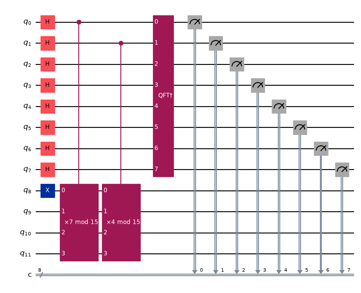
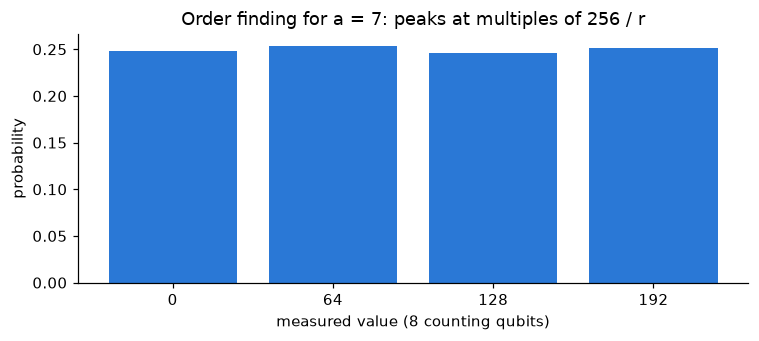

# Quantum Computing with Qiskit

[](https://github.com/marcazdaou/Quantum-Computing/actions/workflows/tests.yml)

Eleven Jupyter notebooks that build quantum computing from the linear algebra up to **Shor's algorithm factoring
15**, implemented in Python with **Qiskit** and run on the Aer simulator. Notebooks 01–09 come from my quantum
computing course (CS 480, UMass Boston); notebooks 10–11 and the test suite extend it.

Every notebook runs from top to bottom on the pinned Qiskit version, and the core circuits are checked by
**physics tests** (exact statevector results) on every push.

| Shor's order-finding circuit for 15 (a = 7) | Measured result: peaks at multiples of 256 / r, so r = 4 |
|---|---|
|  |  |

## Notebooks

| # | Notebook | Highlights |
|---|---|---|
| 01 | [Math foundations](01_math_foundations_and_setup.ipynb) | Complex numbers, vectors and matrices for quantum states |
| 02 | [Single-qubit states](02_quantum_states_and_bloch_sphere.ipynb) | Dirac notation, tensor products, Bloch sphere, gates as rotations |
| 03 | [Gates and superposition](03_quantum_gates_and_superposition.ipynb) | Interference experiments, gate identities, gate decomposition |
| 04 | [Multi-qubit systems](04_multi_qubit_systems_and_tensor_products.ipynb) | CNOT, multi-qubit circuits, cluster states and how to *prove* entanglement (reduced-state purity) |
| 05 | [Bell states](05_bell_states_and_entanglement.ipynb) | The four Bell states, their properties, Bell-basis measurement |
| 06 | [Measurement and interference](06_measurement_born_rule_and_interference.ipynb) | Born rule, collapse, measuring in other bases |
| 07 | [Teleportation and superdense coding](07_quantum_teleportation_and_superdense_coding.ipynb) | Teleportation with every Bell state, debugging both protocols, two-hop teleportation, **entanglement swapping** |
| 08 | [QKD and oracles](08_qkd_oracles_and_deutsch_jozsa.ipynb) | **BB84** key distribution with eavesdropping detection, Deutsch-Jozsa, Bernstein-Vazirani |
| 09 | [Grover's search](09_grovers_search_algorithm.ipynb) | Oracles and diffuser, optimal iteration count, multiple solutions |
| 10 | [Quantum Fourier transform](10_quantum_fourier_transform.ipynb) | QFT circuit proven equal to the DFT, period finding, **phase estimation** |
| 11 | [Shor's algorithm](11_shors_algorithm.ipynb) | Modular multiplication circuits, order finding, continued fractions, **factoring 15 = 3 × 5** |

## Key results

| Algorithm | Result (checked by the tests) |
|---|---|
| Teleportation | Bob's qubit matches the sent state with fidelity 1.0 for arbitrary states |
| Entanglement swapping | Alice's and Bob's qubits agree in 100% of shots in both the Z and X bases, though they never interacted |
| Deutsch-Jozsa | Constant vs. balanced decided with a single query |
| Grover | Marked item found with probability 94.5% (3 qubits), 96.1% (4 qubits) and 99.9% (5 qubits) |
| QFT | Circuit matrix equals the discrete Fourier transform (error ~10⁻¹⁵) and matches NumPy's FFT |
| Shor | Order finding returns the correct order for every base, and factors 15 for every base except 14 (≡ −1, which the theory predicts fails) |

## Run it

```bash
pip install -r requirements.txt jupyterlab
jupyter lab
```

## Tests

```bash
pytest -m "not notebooks"   # 52 physics checks on the circuits in algorithms.py (~20 s)
pytest -m notebooks         # runs all 11 notebooks top to bottom (~2 min)
```

The physics tests use exact statevectors: Bell states are maximally entangled (purity 0.5), teleportation has
fidelity 1, Grover reaches its theoretical success probability, the QFT equals the DFT for 1–5 qubits, every
modular multiplier is correct on all 14 inputs, and Shor's algorithm factors 15. GitHub Actions runs both suites on
every push.

## Repository layout

```
01_…ipynb – 11_…ipynb   Notebooks
algorithms.py           Reusable circuits: Bell states, teleportation, Deutsch-Jozsa, Grover, QFT, Shor (N = 15)
tests/                  Physics tests and the notebook runner
requirements.txt        Pinned versions (Qiskit 2.6, Aer 0.18)
```

## Notes

- Notebooks 01–09 were course assignments. For this repository I re-ran them on Qiskit 2.6 and removed the
  assignment scaffolding. I also completed the unfinished problems in notebook 07 (superdense decoding, the
  debugging exercises, two-hop teleportation and entanglement swapping) and corrected the entanglement argument
  in notebook 04.
- Notebooks 10–11, `algorithms.py` and the tests were added after the course.
